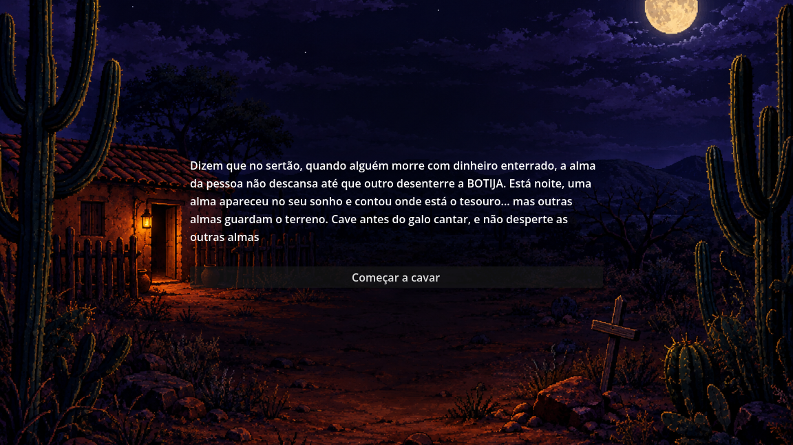
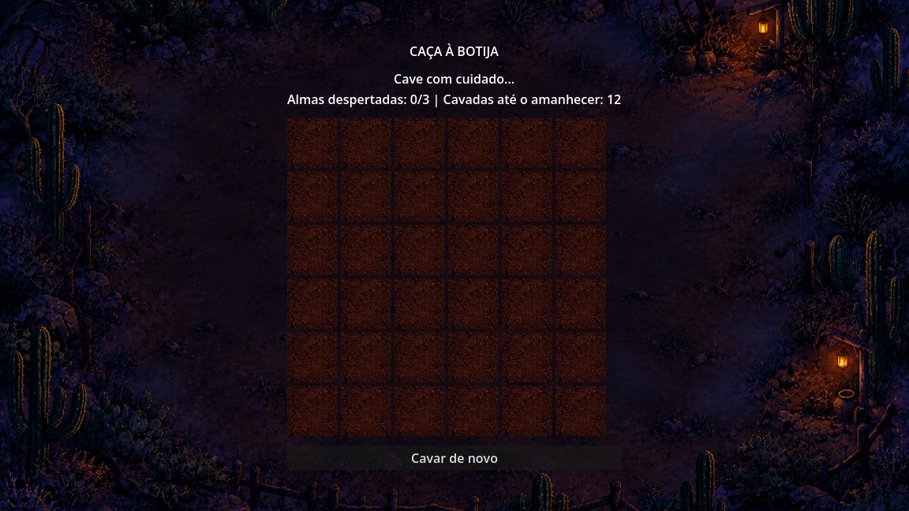
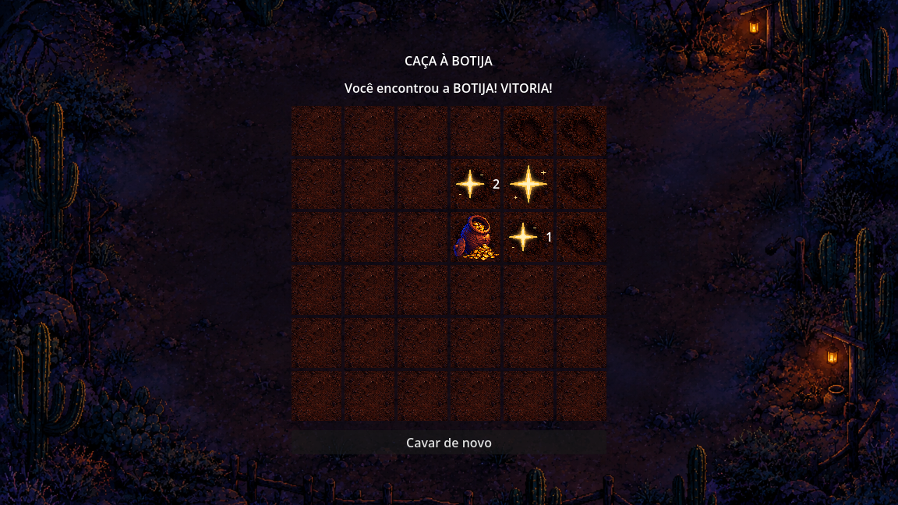
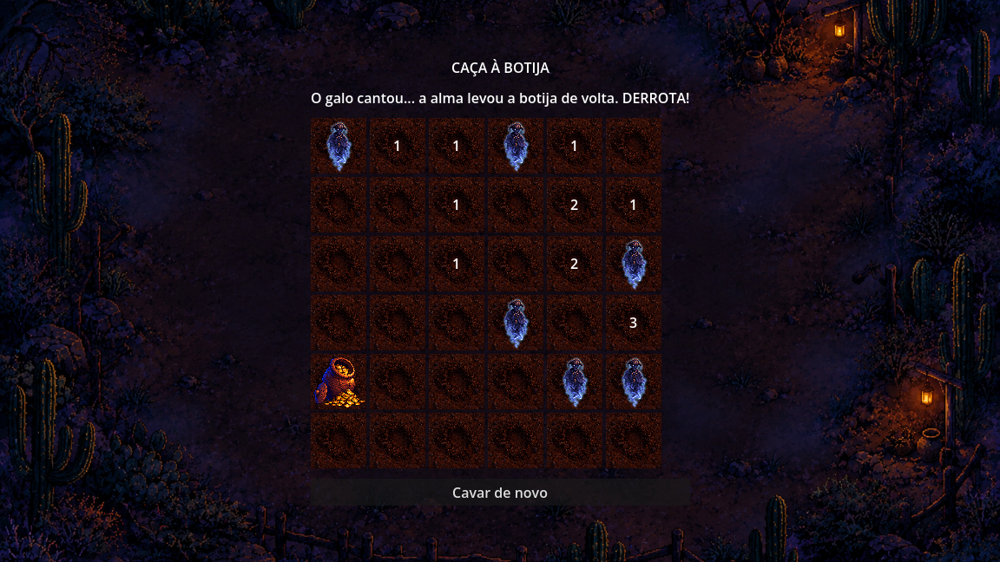

# Caça à Botija

**Trabalho 1 (Demonstração)** da disciplina de desenvolvimento de jogos, com a temática do semestre **"Noites Cabulosas no Ceará"**.

- **Engine:** Godot 4.7.2 (renderizador *Compatibility*)
- **Linguagem:** GDScript
- **Tipo:** jogo 2D de dedução em grade, de interface, single player

---

## Capturas de tela

**Tela de introdução**, contando a lenda da botija:



**Início da partida:** o terreno ainda fechado, com os contadores de almas e de cavadas:



**Vitória:** os brilhos dourados guiaram o jogador até a botija:



**Derrota:** o galo cantou e o terreno foi revelado, mostrando onde estavam as almas e a botija:



---

## 1. A ideia

O jogo é inspirado na **lenda das botijas**, muito presente no sertão nordestino: quando alguém morre deixando dinheiro enterrado em um pote de barro (a botija), sua alma não descansa até que outra pessoa desenterre o tesouro. A alma aparece em sonho para indicar o lugar.

No jogo, uma alma apareceu no sonho do jogador e contou onde está sua botija. Mas o terreno é guardado por outras almas, que não podem ser despertadas. O jogador precisa cavar à noite e encontrar a botija **antes que o galo cante**.

### Como o projeto atende à proposta do professor

| Requisito | Como foi atendido |
|---|---|
| Demo com interface ou elementos 2D | Grade de botões, telas de introdução e de jogo com imagens |
| Temática de terror | Almas penadas, noite de lua cheia, clima sombrio |
| Regionalismo (cultural e natural) | Lenda da botija; sertão, caatinga, mandacarus e casa de taipa nas imagens |
| Regras de vitória e derrota bem definidas | Ver seção 2 |
| Estratégia mínima | Pistas numéricas, brilho da botija e limite de cavadas (seção 3) |

---

## 2. Regras

- O terreno é uma grade de **6 x 6** casas.
- Escondidas nele estão **6 almas** e **1 botija**, sorteadas a cada partida.
- Clicar em uma casa é **cavar**. Cada casa só pode ser cavada uma vez.
- O jogador tem **12 cavadas** antes do amanhecer.

Ao cavar:

- **Casa vazia:** mostra um **número** com a quantidade de almas nas casas vizinhas (as até 8 casas em volta). Se a botija estiver em uma casa vizinha, aparece também um **brilho dourado**.
- **Alma:** a alma desperta.
- **Botija:** o jogador encontrou o tesouro.

**Vitória:** encontrar a botija.

**Derrota (duas formas):**
1. Despertar **3 almas**.
2. Gastar as **12 cavadas** sem encontrar a botija: o galo canta e a alma leva a botija de volta.

Ao fim da partida, o jogo revela onde estavam todas as almas e a botija. O botão **"Cavar de novo"** reinicia com um novo sorteio.

---

## 3. Onde está a estratégia

O jogador nunca deve cavar ao acaso. As decisões vêm de três elementos combinados:

- **Números:** indicam o perigo em volta. Um "0" (casa vazia sem número) significa que todas as vizinhas são seguras; números altos pedem cuidado.
- **Brilho dourado:** indica que a botija está em uma das casas vizinhas, permitindo ir cercando o tesouro.
- **Limite de cavadas:** com apenas 12 cavadas em 36 casas, não dá para cavar tudo. O jogador precisa seguir o brilho e usar os números para escolher o caminho mais seguro e mais curto.

Esse terceiro elemento diferencia o jogo de um campo minado comum: além de evitar o perigo, é preciso **chegar a um objetivo com recursos limitados**.

---

## 4. Estrutura da cena

Todo o jogo está em uma única cena, `main.tscn`:

```
Main (Control)                      ← nó raiz, tem o script main.gd
├── TextureRect                     ← fundo do jogo (fundo.png)
├── VBoxContainer                   ← empilha os elementos do jogo
│   ├── Titulo (Label)              ← "CAÇA À BOTIJA"
│   ├── Status (Label)              ← mensagens e contadores
│   ├── Grade (GridContainer)       ← recebe os 36 botões criados por código
│   └── Button_reiniciar (Button)   ← "Cavar de novo"
└── Intro (ColorRect)               ← tela de introdução, cobre o jogo
    ├── TextureRect                 ← imagem da intro (intro.png)
    └── VBoxContainer
        ├── texto_intro (Label)     ← texto da lenda
        └── Button_comecar (Button) ← "Começar a cavar"
```

**Por que a intro fica por cima:** no Godot, os nós mais abaixo na árvore são desenhados por cima dos anteriores. Por isso o `Intro` vem depois do jogo e o cobre até ser escondido. Pelo mesmo motivo, os `TextureRect` de fundo vêm primeiro, para ficarem atrás.

**Por que a intro está na mesma cena:** em vez de trocar de cena, o painel apenas fica invisível (`visible = false`) ao clicar em "Começar". É mais simples e suficiente para uma demo.

### Configurações importantes dos nós

- **TextureRect (fundo e intro):** âncora *Retângulo Completo*, *Expand Mode = Ignore Size*, *Stretch Mode = Keep Aspect Covered*. Assim a imagem cobre a tela toda sem distorcer.
- **Labels:** *Horizontal Alignment = Center*; o texto da intro usa *Autowrap Mode = Word* e largura mínima de 500, além de sombra para ficar legível sobre a imagem.
- **VBoxContainers:** *Separation* nas *Theme Overrides* para dar espaço entre os elementos.
- **Cor de fundo do projeto:** escura, em *Projeto → Configurações do Projeto → Default Clear Color*.

---

## 5. Imagens (pasta `assets`)

| Arquivo | Uso |
|---|---|
| `intro.png` | Fundo da tela de introdução: casa de taipa, mandacarus e uma cruz marcando o lugar enterrado |
| `fundo.png` | Fundo da tela do jogo: terreiro à noite, cercado de caatinga |
| `terra_fechada.png` | Aparência das casas ainda não cavadas |
| `terra_cavada.png` | Aparência das casas já cavadas |
| `alma.png` | Ícone da alma penada (fundo transparente, clareada e com brilho para se destacar da terra) |
| `botija.png` | Ícone da botija com moedas (fundo transparente) |
| `brilho.png` | Brilho dourado que indica a botija numa casa vizinha (fundo transparente) |

As imagens foram geradas com IA a partir de um guia de estilo comum (pixel art, noite de lua cheia, paleta azul e roxa com luz quente de candeeiro) e com instruções específicas de fidelidade regional: mandacarus em vez de cactos do deserto americano, vegetação de caatinga e serras baixas do sertão.

---

## 6. O código explicado

Todo o código está em `main.gd`, anexado ao nó `Main`.

### 6.1 Constantes

Ficam no topo e concentram as configurações do jogo. Para mudar a dificuldade, basta alterar um número, sem procurar pelo código.

- `IMG_...`: as imagens, carregadas uma única vez com `preload`.
- `LINHAS`, `COLUNAS`: tamanho do terreno.
- `TOTAL_ALMAS`, `ALMAS_PARA_PERDER`, `CAVADAS_ATE_AMANHECER`: regras da partida.

### 6.2 Variáveis de estado

Guardam a situação da partida e podem ser usadas em qualquer função do script.

- `botoes`: um **dicionário** que associa cada posição (`Vector2i(x, y)`) ao seu botão.
- `almas`: lista com as posições das almas.
- `botija`: posição da botija.
- `almas_despertadas`, `cavadas_restantes`: contadores.
- `fim_de_jogo`: impede novas jogadas depois que a partida termina.

### 6.3 Funções

**`_ready()`** — roda uma vez, quando a cena abre. Cria os dois estilos de terra, depois usa dois laços `for` para criar os 36 botões por código (em vez de montá-los um a um no editor). Cada botão recebe tamanho, estilos e cores, e é conectado à função `_ao_cavar` com o `bind(pos)`, que faz o botão "lembrar" a própria posição. Por fim, sorteia os tesouros e mostra o status inicial.

**`_esconder_tesouros()`** — pega todas as posições da grade, embaralha com `shuffle()` e usa a primeira para a botija e as 6 seguintes para as almas. Por isso cada partida é diferente.

**`_vizinhos(pos)`** — devolve a lista das casas em volta de uma posição, percorrendo os deslocamentos de -1 a +1 nos dois eixos, ignorando a própria casa e descartando posições fora da grade.

**`_ao_cavar(pos)`** — o coração do jogo, chamada a cada clique. Desativa o botão, gasta uma cavada e verifica o conteúdo da casa:
- botija → vitória;
- alma → mostra a alma e soma ao contador; na terceira, derrota;
- vazia → conta as almas vizinhas, verifica se a botija está ao lado e mostra o número e o brilho.

Ao final, verifica se as cavadas acabaram. Essa verificação fica **depois** de todo o `if/elif/else` por um motivo: se o jogador achar a botija justamente na última cavada, o `fim_de_jogo` já estará verdadeiro e ele vence, em vez de perder pelo amanhecer.

**`_revelar_tudo()`** — no fim da partida, mostra todas as almas e a botija e desativa todos os botões.

**`_atualizar_status(mensagem)`** — monta o texto de status com a mensagem e os dois contadores. Existe para não repetir a mesma formatação em vários lugares.

**`_criar_estilo(textura)`** — cria e **devolve** (`return`) um estilo de botão que usa uma imagem como fundo.

**`_on_button_reiniciar_pressed()`** — recarrega a cena inteira, o que roda o `_ready` de novo e gera um novo sorteio.

**`_on_button_comecar_pressed()`** — esconde a tela de introdução.

### 6.4 Conceitos de Godot usados

- **Nós e cenas:** o jogo é uma árvore de nós; cada tipo de nó tem uma função (Label mostra texto, Button é clicável, GridContainer organiza em colunas).
- **`@onready` e `$`:** acessam nós da cena pelo caminho na árvore, como `$VBoxContainer/Grade`.
- **Sinais:** o botão emite `pressed` quando clicado; os botões da grade são conectados por código (`pressed.connect`) e os botões fixos pela aba *Sinais* do editor.
- **Propriedades:** o padrão `QUEM.O_QUÊ = VALOR`, como `botao.disabled = true` ou `$Intro.visible = false`.
- **Escopo:** variáveis criadas dentro de uma função só existem nela; as do topo do script valem em todas.
- **Estilos de botão:** cada estado do botão (`normal`, `hover`, `pressed`, `disabled`) pode ter sua aparência. A terra fechada fica nos três primeiros e a cavada no `disabled`; como toda casa cavada fica desativada, o Godot troca a imagem sozinho.
- **Overrides de tema:** `add_theme_color_override` troca cores específicas. Foi usado para que ícones e números não fiquem apagados nos botões desativados, que o Godot deixa transparentes por padrão.

---

## 7. Código completo (`main.gd`)

```gdscript
extends Control

# --- Imagens ---
const IMG_ALMA := preload("res://assets/alma.png")
const IMG_BOTIJA := preload("res://assets/botija.png")
const IMG_TERRA_FECHADA := preload("res://assets/terra_fechada.png")
const IMG_TERRA_CAVADA := preload("res://assets/terra_cavada.png")
const IMG_BRILHO := preload("res://assets/brilho.png")

# --- Configurações do jogo ---
const LINHAS := 6
const COLUNAS := 6
const TOTAL_ALMAS := 6
const ALMAS_PARA_PERDER := 3
const CAVADAS_ATE_AMANHECER := 12

@onready var grade: GridContainer = $VBoxContainer/Grade
@onready var status: Label = $VBoxContainer/Status

# --- Estado do jogo ---
var botoes := {}
var almas := []
var botija: Vector2i
var almas_despertadas := 0
var fim_de_jogo := false
var cavadas_restantes := CAVADAS_ATE_AMANHECER


func _ready():
	grade.columns = COLUNAS
	var estilo_fechado := _criar_estilo(IMG_TERRA_FECHADA)
	var estilo_cavado := _criar_estilo(IMG_TERRA_CAVADA)

	# Basicamente esse for cria todos os botões (36), em vez de criar todos manualmente
	for y in LINHAS:
		for x in COLUNAS:
			var pos := Vector2i(x, y)
			var botao := Button.new()
			botao.custom_minimum_size = Vector2(64, 64)
			botao.expand_icon = true
			botao.add_theme_color_override('icon_disabled_color', Color.WHITE)
			botao.add_theme_color_override('font_disabled_color', Color.WHITE)
			botao.add_theme_stylebox_override('normal', estilo_fechado)
			botao.add_theme_stylebox_override('hover', estilo_fechado)
			botao.add_theme_stylebox_override('pressed', estilo_fechado)
			botao.add_theme_stylebox_override('disabled', estilo_cavado)
			botao.focus_mode = Control.FOCUS_NONE
			botao.pressed.connect(_ao_cavar.bind(pos))
			grade.add_child(botao)
			botoes[pos] = botao
	_esconder_tesouros()
	_atualizar_status('Cave com cuidado...')


func _esconder_tesouros():
	var posicoes = botoes.keys()
	posicoes.shuffle()
	botija = posicoes[0]
	almas = posicoes.slice(1, 1 + TOTAL_ALMAS)


func _vizinhos(pos: Vector2i) -> Array:
	var lista := []
	for dy in range(-1, 2):
		for dx in range(-1, 2):
			if dx == 0 and dy == 0:
				continue
			var v := pos + Vector2i(dx, dy)
			if botoes.has(v):
				lista.append(v)
	return lista


func _ao_cavar(pos: Vector2i):
	if fim_de_jogo:
		return
	var botao: Button = botoes[pos]
	botao.disabled = true
	cavadas_restantes -= 1

	if pos == botija:
		botao.icon = IMG_BOTIJA
		fim_de_jogo = true
		status.text = 'Você encontrou a BOTIJA! VITÓRIA!'

	elif pos in almas:
		botao.icon = IMG_ALMA
		almas_despertadas += 1
		if almas_despertadas >= ALMAS_PARA_PERDER:
			fim_de_jogo = true
			_revelar_tudo()
			status.text = 'As almas te levaram... DERROTA!'
		else:
			_atualizar_status('Uma alma despertou!')

	else:
		var qtd := 0
		for v in _vizinhos(pos):
			if v in almas:
				qtd += 1
		var texto := ''
		if qtd > 0:
			texto = str(qtd)
		if botija in _vizinhos(pos):
			botao.icon = IMG_BRILHO
		botao.text = texto
		_atualizar_status('Continue cavando...')

	if not fim_de_jogo and cavadas_restantes <= 0:
		fim_de_jogo = true
		_revelar_tudo()
		status.text = 'O galo cantou... a alma levou a botija de volta. DERROTA!'


func _revelar_tudo():
	for a in almas:
		botoes[a].icon = IMG_ALMA
	botoes[botija].icon = IMG_BOTIJA
	for b in botoes.values():
		b.disabled = true


func _atualizar_status(mensagem: String):
	status.text = '%s\nAlmas despertadas: %d/%d | Cavadas até o amanhecer: %d' % [
		mensagem, almas_despertadas, ALMAS_PARA_PERDER, cavadas_restantes]


# Cria um estilo de botão que usa uma imagem como fundo.
func _criar_estilo(textura: Texture2D) -> StyleBoxTexture:
	var estilo := StyleBoxTexture.new()
	estilo.texture = textura
	return estilo


func _on_button_reiniciar_pressed() -> void:
	get_tree().reload_current_scene()


func _on_button_comecar_pressed() -> void:
	$Intro.visible = false
	_atualizar_status('Cave com cuidado...')
```

---

## 8. Testes realizados

Para testar sem depender da sorte, foram usados temporariamente `print('Botija em: ', botija)` e `print('Almas em: ', almas)` no `_ready`, mostrando as posições no painel *Saída* (removidos na versão final). Para os testes de amanhecer, o limite de cavadas foi reduzido temporariamente para 3.

| # | Cenário | Resultado esperado |
|---|---|---|
| 1 | Cavar uma casa vazia | Contador de cavadas diminui em 1 |
| 2 | Cavar a botija | Vitória |
| 3 | Cavar 3 almas | Derrota e revelação do terreno |
| 4 | Gastar todas as cavadas em casas vazias | Derrota pelo galo |
| 5 | Achar a botija na última cavada | **Vitória** (não derrota) |
| 6 | Cavar ao lado da botija / de almas | Aparece o brilho / número correto de almas |
| 7 | "Cavar de novo" | Novo sorteio, contadores zerados |
| 8 | "Começar a cavar" | A intro some e o jogo aparece |

---

## 9. Como executar

O jogo está publicado no itch.io e pode ser jogado direto no navegador: https://joaolucasptaveira.itch.io/caa-botija-1-trabalho

Para abrir o projeto:


1. Abrir o Godot 4.7 e importar a pasta do projeto (arquivo `project.godot`).
2. Pressionar **F5**. A cena principal é `main.tscn`.

---

## 10. Possíveis melhorias futuras

- Sons: vento, grilos, som de terra cavada e de alma despertando.
- Marcar casas suspeitas com uma cruz usando o botão direito do mouse.
- Níveis de dificuldade (grade maior, mais almas, menos cavadas).
- Animação da alma surgindo ao ser despertada.
